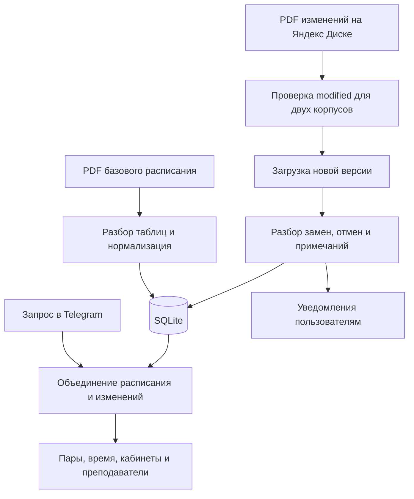

<div align="center">


# scheduleBot

**Telegram-бот с расписанием пар колледжа и автоматической обработкой изменений из PDF**

[Как работает парсер](#как-я-разбирал-pdf) · [Структура](#структура-проекта) · [Технические заметки](docs/TECHNICAL.md) · [Кейс для портфолио](docs/PORTFOLIO.md)

</div>

## Мой первый проект

Я создал scheduleBot за месяц, начав с нуля и без опыта написания кода. Мне хотелось решить конкретную задачу: превратить расписание колледжа и ежедневные PDF с изменениями в понятный сервис внутри Telegram. Вместо поиска своей группы в документах студент мог открыть бота и сразу получить актуальные пары.

Во время разработки я освоил основы программирования: функции, коллекции, условия, обработку ошибок, работу с файлами, базой данных и внешними API. Я учился по мере решения реальных задач — и именно тогда по-настоящему влюбился в программирование.

Этот проект остаётся для меня самым любимым. Сегодня я вижу, что его код можно сделать гораздо чище, но особенно горжусь самостоятельными решениями и логикой обработки расписания. Здесь я много думал, экспериментировал и впервые почувствовал, что могу придумать и создать полезный продукт.

## Что умеет бот

Я реализовал расписание для студентов и преподавателей с учётом группы, корпуса, подгруппы, дня и верхней или нижней недели. В интерфейсе можно переключать даты, смотреть пары на сегодня и завтра, находить расписание другой группы или преподавателя и отправлять его через inline-режим Telegram.

Основное расписание дополняется ежедневными изменениями: заменами преподавателей и дисциплин, отменами, переносами, дополнительными занятиями, практикой и экзаменами. Бот показывает результат с временем пары, кабинетом и пояснениями, а не просто пересылает исходный PDF.

Кроме расписания я добавил домашние задания, настройки профиля, утренние напоминания и уведомления об обновлениях. Административные команды позволяют управлять ссылками на документы, смотреть статистику и отправлять сообщения. В проекте также есть подписки, реферальные бонусы и пополнение через YooMoney; часть возможностей зависит от подписки и настроек пользователя.

## Как я разбирал PDF

Самой сложной и интересной частью стал собственный алгоритм разбора документов. Я использовал `pdfplumber` для извлечения текста и таблиц, а поверх него написал правила, учитывающие устройство расписания моего колледжа.

### Базовое расписание

PDF-таблицы нельзя было просто прочитать построчно: данные распределены по страницам, в ячейках встречаются переносы строк, объединённые области и несколько преподавателей для одной пары. Я восстанавливал контекст дня, определял группы по заголовкам, обрабатывал разные варианты расположения таблиц и отделял номер пары, кабинет, дисциплину и преподавателя.

Для занятий по подгруппам я выделял отдельные записи. Повторяющиеся элементы использовал для различения недель и подгрупп, а названия дней приводил к единому представлению. Результатом становился словарь расписания по группам, пригодный для дальнейшей работы с базой.

### Ежедневные изменения

Для документов с заменами я написал отдельный разбор. Он извлекает дату и тип недели из заголовков, восстанавливает пропуски в объединённых ячейках и распознаёт особые случаи: «нет замены», «дистанционно», «перенос», «дополнительно», практику и экзамены. Общие примечания сохраняются отдельно и сопоставляются с группами и преподавателями.

При формировании ответа я объединяю базовое расписание с изменениями на выбранную дату. Важная часть этой работы — учитывать изменения у одной или обеих подгрупп, сохранять обычные занятия и понятно выделять отменённые и добавленные пары.

На расписании моего колледжа система корректно определяла пары и без ошибок отрабатывала ежедневные изменения. Именно этой частью проекта я горжусь больше всего: я самостоятельно разобрался в сложном формате документов и превратил набор исключений в работающий алгоритм.

## Как я отслеживал обновления

Для двух корпусов работают отдельные циклы проверки документов на Яндекс Диске. Я сравниваю поле `modified` из API с сохранённой версией. Если файл обновился, бот скачивает PDF, заново разбирает его, заменяет ранее сохранённые записи за день и отправляет уведомления с учётом группы и настроек пользователя.

Это проверка версии исходного файла и повторная обработка документа, а не сравнение PDF по отдельным строкам. Такой подход позволил автоматически подхватывать ежедневные публикации и повторные исправления расписания.



## Технологии

| Задача | Решение |
| --- | --- |
| Telegram-интерфейс | Python, aiogram 3, routers, FSM, inline-запросы |
| Разбор PDF | pdfplumber, регулярные выражения, собственные правила нормализации |
| Хранение | SQLite, модуль sqlite3 |
| Получение документов | requests, API Яндекс Диска |
| Фоновые проверки и уведомления | asyncio |
| Подписки и пополнение | python-dateutil, YooMoney |

## Структура проекта

```text
main.py                         # Запуск основного бота
bot.py                          # Подключение Telegram и SQLite
schedule.py                     # Изменения и формирование расписания
utils.py                        # Загрузка PDF, мониторинг и уведомления
handlers/
├── students.py                 # Расписание, навигация и домашние задания
├── inline.py                   # Поиск групп и преподавателей
├── profile.py                  # Профиль, подписки и пополнение
├── admin.py                    # Администрирование и запуск мониторинга
└── middlewares.py              # Обработка активности и антиспам
config/
├── schedule_pars/campus_1.py    # Парсер базового расписания
├── database.py                 # Запросы к SQLite
├── states.py                   # Состояния диалогов
├── markups.py                  # Клавиатуры
└── texts.py                    # Тексты и конфигурация
photo/                          # Графические материалы бота
doc/                            # Пользовательские документы
```

В исходниках также сохранён `main_love.py` — отдельный экспериментальный бот знакомств для колледжа. Он не является точкой входа бота расписания.

## Состояние исходников

Я сохраняю этот репозиторий как свой первый проект и историю начала работы с кодом. Его ценность для меня — в решённой задаче, самостоятельном алгоритме и опыте создания продукта за месяц. При дальнейшем развитии я бы разделил большие функции, вынес конфигурацию из кода, добавил миграции и проверки на коллекции PDF.

При подготовке описания я повторно проверил парсеры на документах из репозитория: 11 PDF базового расписания дали 1 390 записей, а два PDF изменений — 32 элемента результата, включая заголовки. Все файлы обработались без исключений. Это проверка выполнения на сохранённых примерах; полную сверку каждой пары с оригиналом я в неё не включал.

Перед публикацией я вынес секреты и административные ID в переменные окружения, удалил пользовательские базы и служебные файлы. Для создания чистой SQLite-базы сохранил схему без данных и добавил `scripts/init_db.py`. Порядок подготовки окружения и ограничения исторической версии я описал в [технических заметках](docs/TECHNICAL.md).
